  <!-- All visual assets live in this repository to avoid unavailable image services. -->
  

  <h2>Hi 🏀, I'm Wj</h2>

  
软件开发工程师 · 喜欢 AI、编程，还有篮球

  
目前在盛趣游戏，做 VibeCoding 火山云架构重构。

  

  <!-- Preserve the original animated contribution graph and both color schemes. -->
  <picture>
    <source media="(prefers-color-scheme: dark)" srcset="profile-snake-contrib/github-contribution-grid-snake-dark.svg" />
    <source media="(prefers-color-scheme: light)" srcset="profile-snake-contrib/github-contribution-grid-snake.svg" />
    
  </picture>

## 🛰️ 工作与项目 Work & Projects

### 盛趣游戏

**软件开发工程师** · 2026-09-17 — 至今

- **主要项目**：VibeCoding 火山云架构重构。

### 上海喜马拉雅科技有限公司

**服务端开发工程师** · 2025-01-02 — 2026-09-15

- **主要项目**：
  - 喜马拉雅儿童 App / 奇奇学 App
  - AI 助教系统 & 奇奇学技术助手
  - 奇奇学 WiFi 点读笔

### 上汽通用汽车有限公司

**软件开发工程师** · 2022-07-05 — 2024-07-12

- **主要项目**：
  - 凯迪拉克数据分析系统
  - 通用经销商售后服务系统
  - 品牌指标一体化项目

### 海加网络科技有限公司

**C++ 实习工程师** · 2019-07-01 — 2019-08-31

- **主要项目**：集中文印项目。

## 🎓 教育经历 Education

### 苏州大学 · 硕士

**计算机技术** · 2019-09 — 2022-06

- 研究方向：倒排索引压缩、DHT 网络。

### 江西财经大学 · 本科

**软件工程** · 2015-09 — 2019-06

- 主修课程：数据结构、操作系统、计算机网络。

## 📡 交个朋友 Connect

- 邮箱：[798989631@qq.com](mailto:798989631@qq.com)
- GitHub：[jcsdwj](https://github.com/jcsdwj)
- 微信：`crazy4wj`
